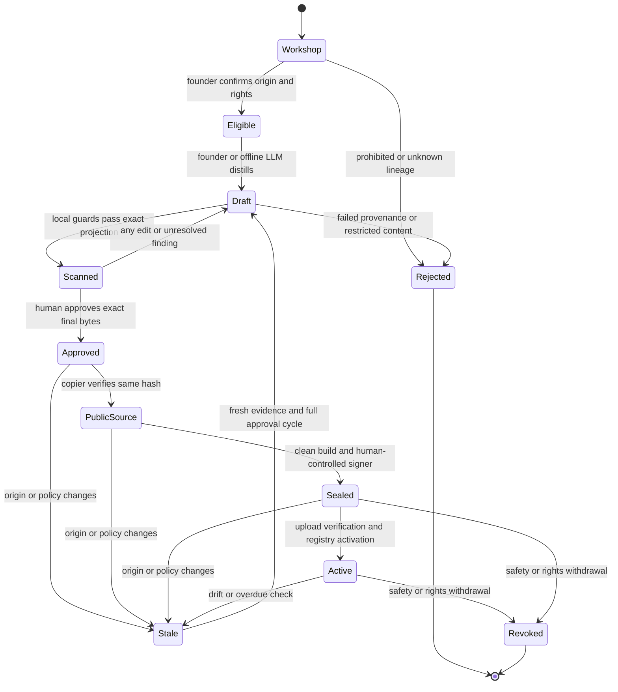

## 要約
- 全脳の切り出しではなく、来歴を確認できる個人の運用知識から新しい公開ページを作る。
- 業務・顧客・第三者の非公開情報、会話由来・夢生成ページは、匿名化しても初回販売の材料にしない。
- 公開用 source は整理の単位とし、配信は承認済みの固定バンドルだけで行う。
- 初回は最大30ページ、単独実装なら15ページを基本とし、審査を急いで枚数を増やさない。
- 元ページの識別子とハッシュは手元だけに保存し、公開引用は公開ページのIDとハッシュに限定する。
- 元データの変更・削除・撤回を検知したら販売を止め、再審査する。配布済み情報の回収は保証しない。
- 約10件の再現評価で有用性と悪化を測り、一般的なチェックリストとの差がなければ商品を見直す。

# 05 — Slice readiness

Status: proposed implementation contract, 2026-10-08. Read in order: [00 brief](00-brief.md), [00a binding seller priorities](00a-seller-priorities.md), [01 architecture](01-architecture.md), [02 economics and trust](02-economics-trust.md), [04 seller data and hosting](04-seller-data-and-hosting.md). This is Part D required by P3. It creates no content inventory, approval, deployment, consent, or runtime evidence. No private brain was inspected for this design.

**Decision:** S-C content + S-B local publication source + S-A's allowlist/review/seal procedures; serve a newly built frozen bundle under H4 + H2, with 04's isolated H1 fallback. The source is an authoring convenience, never the internet-facing security boundary. Start with 15 independently supported agent-ops pages; expand to 30 only within the budget below. A public slice is sellable synthesis, not secret information.

`POLICY` denotes a chosen rule or threshold. Estimates and installed-capability hypotheses are **UNVERIFIED**; D10 gives 30-minute verification caps and fallbacks. Dates/deadlines are JST; Singapore is one hour earlier. Day 1 is Oct 8, day 2 Oct 9, day 3 Oct 10, day 4 Oct 11. Roles below may all be the founder; role names do not imply extra staffing.

## Conflicts found

These documents were separate passes. The following are explicit proposed resolutions for this lane, not edits to those documents. R-01 must settle the shared wire contract before integration; no implementation may claim compatibility with both incompatible formats. During final validation, 02 was independently updated; its revised B+ economics and Oct 10 Gate-2 deadline were re-read and incorporated here.

| Conflict | Resolution used here; consequence / owner |
|---|---|
| P3 says distill from private material; 01 §7, 02 introduction and 04 A1/A5 reject business-derived and restricted generated material. | “Private workshop” means unpublished **eligible personal** observations, not a declassification service. No transcript/dream override in four days. Independently reproduced new evidence may support a new article, without laundering restricted lineage. Founder owns eligibility. |
| P3 suggests 30–60 pages; 01 caps at 30 pages/64 KiB; 04 starts at 10–30 but permits larger format limits. | Use 30/64 KiB as hard prototype ceilings, 200–350 words/page as authoring target, 15-page normal fallback. Sixty is a later experiment, not a deliverable. If 04's automated PII fallback fires, its **10-page** ceiling supersedes 15. |
| 01 provides public whole-page routes and independent excerpt verification; 04 A3/A4 prohibits those routes and trusts seller span assertions. | Choose 01's whole approved-page verification. All published bytes are public-safe. Retain 04's answer quote caps for concise responses, explicitly not copy protection. D5 defines the namespace. If the founder requires secret source text, this design is unsuitable. |
| 01 uses domain-separated Ed25519 over JCS payloads with Ks; 04 uses exact-file Minisign seals, delegated online keys and signed registry revisions. | Prefer 01's single wire/signature contract for four days. Extend its manifest payload with 04's strict payload-file inventory and version/policy fields; do not ship a parallel Minisign/delegation protocol. 01 owner must approve the additive schema in R-01. Freeze exact page bytes independently of JSON canonicalization. Keep 04's denylist/freshness behavior; authenticated registry status format needs integration confirmation. |
| 01 caches/signs the answer before quoting with a salted commitment; 04 signs after payment and suppresses the commitment. | Preserve 01's B+ immutable prepared answer and pre-payment signature; reveal after verified payment. Revised 02 now agrees that all preparation cost belongs to unpaid pre-check economics and distinguishes technical-test pricing from pilot pricing. No post-payment regeneration or margin claim. |
| 01's durable paid-answer support window versus 04's safety revocation and shorter cache window. | Safety revocation wins: stop even pending/cached reveals and use manual full-price recovery under 02. Ordinary non-safety supersession preserves 01's 30-day paid-answer recovery window. D6 separates the cases. |
| Remaining differences include 04 versus 01/02 request limits, inference calls and TTL; 01 versus 02 trust formulas; signing/runtime choices; and all three answer/quotation caps. | D7 uses 01's retrieval/support contract and 04's worker isolation. D5 takes the stricter compatible output limits: 01's 1,500-character answer, 02's 200-character total quotation/three citations, and 04's per-page fraction cap, with Unicode scalars as the counting unit. Runtime/payment/trust policies still need one R-01 contract; no silent blend of incompatible settings. |
| The initial 02 allowed Gate 2 before Oct 11 noon; its revision now agrees with 01's Oct 10 18:00. 04's seller engineering alone totals four days. | Keep the reconciled Oct 10 gate. R-tasks overlap 04's work, not an additional staffed lane. A solo founder must cut pages and optional tooling early; no claim that all documents' additive estimates fit four days. |

## D1. The problem restated: what "not built for slicing" means concretely for gbrain's data model

The founder's reported inventory is one `default` source, approximately 12k pages and 160k chunks, including notes, atoms, transcripts, reflections, concepts, originals, ideas and patterns. These are brief observations, not a verified current census. A type describes shape, not rights. A `pattern` can still summarize a customer conversation. Known provenance fields are `raw_source`, `source_kind`, `ingested_via`, `dream_generated`; their actual local value vocabulary is **UNVERIFIED**.

Public documentation read on 2026-10-08 establishes the following limited facts; moving `master` documentation is not proof about the installed binary:

| Evidence | Implication for this design |
|---|---|
| A brain is a database; sources share it. Page identity is `(source_id, slug)`. Docs describe remote source grants, private-page filtering and operator-dependent behavior; local files/shared DB credentials are outside that grant boundary. [Brains and sources](https://github.com/garrytan/gbrain/blob/master/docs/architecture/brains-and-sources.md) | Do not assert that gbrain has no access controls. Do assert that this founder's existing source is not a publication partition. Test installed behavior with synthetic controls; never expose it as the slice server. |
| Structured frontmatter is available for metadata/filtering, but scalar values are not indexed by ordinary body search. [Recommended schema, file-layer conventions](https://github.com/garrytan/gbrain/blob/master/docs/GBRAIN_RECOMMENDED_SCHEMA.md#file-layer-conventions) | A search for `dream_generated` is not a provenance audit. Read parsed metadata before considering body hits. Our readiness fields are publisher policy, not assumed native authorization. |
| File-backed Markdown/frontmatter can reconstruct represented knowledge; chunks/embeddings are derived, while DB-only knowledge, history and withdrawal state have separate persistence. [System of record](https://github.com/garrytan/gbrain/blob/master/docs/architecture/system-of-record.md) | Copying files is neither a complete backup nor proof that no withdrawn claim remains. Check authoritative current state before selection; build a fresh public index. |
| Search can deliver chunks, windows, sections or whole pages; `auto` can expand conversation hits. Returned match spans use UTF-16 coordinates. [Evidence delivery](https://github.com/garrytan/gbrain/blob/master/docs/evidence-delivery.md) | A safe-looking snippet does not establish that the fetched page is safe. Do not reuse native offsets as our UTF-8 citation spans. |
| Configured providers may receive text; Markdown export is not a full backup, and page writes and graph reconciliation are separate outcomes. [Memory boundaries](https://github.com/garrytan/gbrain/blob/master/docs/guides/memory-boundaries.md) | Selection and distillation stay offline until approval. Import/export, metadata retention and link behavior need separate round-trip checks. |

Specific naive-extraction failures:

1. **Source-only allowlist:** `default` selects nearly everything; a bound source or federated read grant is not a page-by-page sale authorization.
2. **Type/tag-only allowlist:** `concept`, `original`, `public` or absence of a provenance flag can admit inherited private material. Generated summaries can hide their parents or invent support.
3. **Text-only redaction:** titles, aliases, filenames, YAML, comments, fenced examples, URLs, local paths and log timestamps reveal identities or affiliations. Hashing private content publicly can permit confirmation attacks.
4. **Recursive export:** following outgoing links, backlinks, related pages or evidence parents imports exclusions. Keeping private slugs as broken links still advertises their existence. Graph degrees can expose excluded neighbors.
5. **Shared-index shortcut:** copying a DB, chunks, vectors, graph rankings, cached answers or search suggestions preserves excluded information even if visible Markdown is filtered. These are risks of reusing artifacts, not a claim that current remote authorization necessarily leaks.
6. **Chunk-only review:** a selected chunk loses negation, version constraints, failed attempts or a retraction elsewhere on the page; neighborhood retrieval can cross back into excluded material.
7. **Generated-page shortcut:** dream/transcript-derived pages can mix unrelated personal and business sources. Removing `dream_generated` does not establish rights or factual accuracy.
8. **Live source sync:** post-approval edits, auto-enrichment and stale indexes change sold knowledge without review. Same slug can resolve differently across sources; unchanged URL can hide changed bytes.
9. **Context amputation:** dropping a supporting page can turn a narrowly measured lesson into a universal claim. Without public evidence sufficient to understand it, reject the claim rather than cite a hidden authority.

Readiness means an explicit publication lineage and workflow exist for **a small subset**. It does not require reorganizing or labeling all 12k pages.

## D2. Strategy comparison S-A, S-B, S-C (+ any better hybrid)

Estimates below are **UNVERIFIED founder content hours for 30 short pages**, excluding shared publishing/service implementation. R-02 and V-05 calibrate with five candidates; unavailable evidence triggers the smaller scope.

| Strategy | Leakage risk / fidelity | Founder time / tooling | Native compatibility / reversibility | Strangers later |
|---|---|---|---|---|
| S-A: exact allowlisted copies from existing source | Highest residual context/metadata risk; strongest wording fidelity, but broken supporting graph may mislead. | 4–7 h **if** already-public originals exist; otherwise unbounded review. Exact-page selection, projection, scanners, diff, seal. | Reuses Markdown/provenance; no assumption of native subset export. Originals untouched; published copies cannot be recalled. | Only for already publication-ready collections with credible rights. Bad default for mixed brains. |
| S-B: approved copies in dedicated source, then export | Better organization; copying alone does not remove inherited secrets. Co-location still shares trust with local DB users. | S-A review cost plus 0.5–1 h source setup/round trip. | Native source/tag/link/search affordances locally; source-specific enrichment controls **UNVERIFIED**. Remove staging copies without changing originals; external copies remain. | Useful authoring UX after isolation tests, insufficient as service boundary. |
| S-C: new clean-room articles from eligible evidence | Lowest relative leakage risk; loses narrative detail and can introduce unsupported generalization. “Clean-room” is editorial separation, not legal proof of independent creation. | 8–12 h with authoring, evidence review and safety gate; local drafting templates, lineage ledger. | Ordinary Markdown; no dependence on generated graph. Private pages untouched. Easily reject drafts; cannot retract learned public information. | Best default if seller has demonstrable ownership, evidence and review time. |
| **Chosen hybrid: S-C → S-B → sealed S-A gate** | S-C's minimization plus explicit exact-byte boundary; no private index/graph at runtime. | ~10 h target / ~6 h at 15 pages; reuse 04 publisher, add small lineage check. | S-B is optional locally; public Markdown directory is fallback. New index only. Old approved versions remain auditable, subject to revocation. | Reproducible manual process before self-service tooling. |
| Alternative: author from new public experiments only | Avoids uncertain historic provenance; may lose founder's measured historical advantage. | 30-minute feasibility probe, then bounded new experiments; potentially fewer than 15 lessons. | Needs no private access or native source feature. | Strong fallback, but call it a new runbook, not an extracted brain product. |

**Four-day selection:** the hybrid, with no bulk brain migration and no public gbrain grant. Use a local `slice-public` source only after V-02 proves approved-only import/readback; otherwise keep the same approved Markdown in a dedicated directory. S-B may be a source in a separate local publication brain if setup is already available, but never clone the private DB to create it. Do not spend the deadline proving co-located serving safe.

**Long-term target:** publish-by-default **authoring**, not auto-publication: new personal experiments are written with measured evidence and rights metadata in the private workshop, then distilled, reviewed and promoted continuously. Source labels and read grants can improve local ergonomics; keep sealed releases and separate runtime storage for strangers. This offers incremental readiness without retroactively blessing the archive.

Evidence that reverses choices: five-candidate review finding at least four already-public owned pages with complete lineage and no meaningful projection changes justifies S-A for those pages. Failure to produce three accurate, eligible pages within the first 30-minute content trial triggers the 15-page/new-experiment fallback. If no eligible evidence supports the topic, abandon historical distillation. Revisiting live native serving requires a pinned release, source/grant/graph/chunk/cache/withdrawal adversarial tests and operational revocation proof across every exposed endpoint; a documented grant or one passing search does not suffice. This evaluation is outside the four days.

## D3. Minimal metadata schema for slice-readiness

Keep nine readiness fields, plus existing `title`, `type`, `tags` and a publisher-generated opaque public `page_id`. Do not migrate the archive. Store these fields in **new candidate frontmatter**; private lineage details may live in a companion local ledger. The exported page is an explicit projection, never a copy of all YAML. Missing, duplicate, malformed or unknown values fail closed. YAML is parsed as data with no custom tags/execution.

| Field | Allowed meaning / validation | Public projection |
|---|---|---|
| `visibility` | `private` while drafting; `public` only on approved projection. These are our labels; do not rely on native interpretation of `public`. | `public` |
| `origin` | `personal_public_ops` or `consented_public_source`; unknown is ineligible. Detailed source classification and independent support live locally. First slice uses only the first. | Normalized enum only; maps to 04's `seller_original` where applicable. |
| `sensitivity` | `none`, `uncertain`, `restricted`; only `none` eligible, assessed with complete lineage. | `none` |
| `review_status` | `draft`, `scanned`, `approved`, `rejected`, `stale`, `revoked`. Local state machine controls transitions; text alone never grants approval. | `approved` in frozen bytes; subsequent status is an external overlay. |
| `derived_from` | Nonempty list of exact source snapshot SHA-256 values in local candidate. Ledger maps each to `(brain, source, slug/revision or canonical file)`, evidence type, current withdrawal status, rights and public descendants. Fresh experiments hash their newly recorded evidence too. | **Omit entirely.** No private hashes, parent counts or private identifiers. Public-to-public evidence references belong in approved body text. |
| `reviewer` | Accountable human handle; LLM cannot fill an approval. | Consented pseudonymous seller handle. |
| `last_reviewed` | UTC RFC3339 time, null before approval. Distinct from automated drift-check time. | Approval time only; never claim continuous freshness. |
| `license` | Publication terms identifier; `LicenseRef-AAB-Public-Synthesis-v1` is a proposed product-specific identifier, not a verified legal instrument or open-source license. | Terms ID only; cannot activate until actual terms are reviewed and available. |
| `right_to_sell` | Local object: `attested` boolean and random `record_id`; false blocks. Record covers authorship, exact bytes, no employer/customer/member material, provider disclosure and irrevocability of distributed copies. | Boolean + opaque approval reference only; omit contracts and participant identities. |

Example 1: invented local draft about a toy retry counter. Repeated digits are placeholder hashes and **must fail a production gate**; no real source or measurement is asserted.

```yaml
---
title: "Bound retries in a toy worker"
type: pattern
tags: [personal-harness, retry-budget]
visibility: private
origin: personal_public_ops
sensitivity: none
review_status: draft
derived_from:
  - "sha256:1111111111111111111111111111111111111111111111111111111111111111"
reviewer: null
last_reviewed: null
license: LicenseRef-AAB-Public-Synthesis-v1
right_to_sell:
  attested: false
  record_id: null
---
```

Example 2: invented approved-public projection of a separate toy completion-check article. A fixture approval is not a real approval. The private ledger retains evidence hashes; their absence here is intentional.

```yaml
---
page_id: public/p_7c42a9e103bd46f2
title: "Require a visible completion check"
type: pattern
tags: [agent-completion-checks]
visibility: public
origin: personal_public_ops
sensitivity: none
review_status: approved
reviewer: seller-demo
last_reviewed: "2026-10-09T02:00:00Z"
license: LicenseRef-AAB-Public-Synthesis-v1
right_to_sell:
  attested: true
  record_id: approval_8f43e2
---
```

To avoid self-referential approval hashes: human selects the final review metadata, views the complete projected bytes including that metadata, then approves their hash in a separate local approval record. The tool cannot stamp another timestamp into the file afterward. Seal records bind public page hashes, policy digest and approval ID; the private ledger separately binds reviewed source snapshots. Do not publish a digest of a guessable private review report. This narrows 04's proposed public scan-evidence digest to **sanitized public gate evidence** only; full scan evidence remains local.

## D4. The promotion workflow (private workshop -> distill -> scan -> human approval -> public source -> sealed bundle)



Forbidden transitions: Workshop/Draft/Scanned → PublicSource/Sealed/Active; Rejected → Approved; Stale → Active by toggling a label; Revoked → Active for the same digest; any LLM/scanner → human approval; public service → private retrieval. A revised version follows the entire pipeline and receives a new seal. Ordinary superseded safe versions can support already paid receipts, but cannot be newly purchased.

| Step / actor | Evidence recorded locally | Completion condition |
|---|---|---|
| Select / founder with metadata helper | Candidate IDs, type/tag, provenance vocabulary, exclusions, current source revision, rights basis; no body in shared logs. | Each selected origin is eligible. Unclear business dependence means exclude, not redact. |
| Distill / founder, optional offline LLM | Input snapshot hashes, prompt/model version if used, draft revision, measurement/support map, edits and uncertainty. | New standalone article, no raw conversation or private references; reviewer can trace each measured claim. |
| Scan / deterministic publisher-owned guards | Whole-input/projection byte coverage, tool/config versions, rule IDs, redacted findings, graph closure and namespace checks. | Mandatory secret/business guards succeed; no unresolved flags. Clean control must pass and bad controls must fail. |
| Review / founder | Full-text view acknowledgement, per-page checklist, rights attestation, exact approved hashes, reviewer/time/policy. | Human deliberately approves each page; signer access or green scan is not approval. |
| Promote / deterministic copier | Approved input hash, output hash, public-only fields and links; native import/readback if used. | Approved bytes are immutable authority. Native changes are not silently exported. |
| Seal / builder and human-controlled signing interface | ID set equality, fresh chunk spans/index file hashes, manifest payload, signature/public key ID, approval reference. | No unlisted payload, external references or private metadata; all bytes verified. |
| Activate / seller and registry operator | Remote digest check, readiness/revocation controls, public preview and price/terms approval. | Same approved bundle served; no private mounts, credentials or native search route. |

All unapproved inputs stay on the seller's machine. A hosted authoring agent must not receive raw candidates merely because its harness is local. If there is no verified offline model, the founder drafts manually; 30-minute offline-model setup is a hard cap, not an excuse to upload. Even local drafting gets only eligible selected material, not 12k pages. Runtime hosted inference may receive approved-public excerpts under 04's provider policy.

Distillation rules:

- **Remove identifying context:** person names/handles, employers, customers, member information, contact details, private project names, domains/URLs, filesystem paths, issue/commit identifiers, access tokens, unique dates/amounts and combinations of specifics that identify a third party. For this slice, no URLs or paths inside article content; generic placeholders in technical examples must themselves be reviewed. Public technical identifiers needed for reproducibility may remain if unrelated to a private party. Do not replace a name with “Customer A” and claim anonymity.
- **Keep the measured lesson:** initial condition, observable failure, tested fix, exact relevant technical constraint/version, number of trials, comparison method, outcome and limitation. Preserve negative trials and failed fixes. A measurement whose context cannot be safely described is omitted along with the performance claim, not converted into an invented rounded number.
- **Keep enough public evidence:** a short original, safe reproduction with before/after output or an explicit observation table in the page. Label historical personal observation, fresh experiment and hypothesis separately. Original raw logs need not be public, but a claim supported only by inaccessible private context cannot be sold as reproducible. Never invent timings, prevention counts or a causal explanation.
- **Keep operational intent without authority:** explain when/why to run a check and its expected output. Do not embed system-prompt overrides, wallet destinations, remote fetch instructions, executable HTML or agent configuration. Examples are inert data, never executed during scan/review.
- **Reject forbidden lineage first:** transcript/dream-derived and employer/customer/private-third-party content never becomes eligible through these removal rules. A new neutral experiment may be separately eligible only if it establishes the entire claim independently and uses no restricted scenario/data. Any unresolved dependence excludes it.

Per-page human checklist, **target 150 seconds** for a 200–350-word page, not a time limit that grants approval:

| Time | Question; failure action |
|---|---|
| 0–25 s | Is the origin affirmatively personal/owned and independent of excluded material? Is the evidence map complete? Unknown → reject/defer. |
| 25–75 s | Read every final byte, title and metadata. Could a colleague identify a third party? Any secret, URL, path, hidden content or private link? Yes/uncertain → reject. |
| 75–115 s | Are failure, fix, measurement, conditions and limitations accurate? Does public evidence support every useful claim? No → draft again or remove claim. |
| 115–140 s | Does the article remain meaningful without its private graph? Any unsafe operational instruction or contradictory advice? Yes → repair/review. |
| 140–150 s | Confirm final hash, rights/terms and public disclosure; record approval. Changed hash → restart review. |

If origin checking or evidence assessment needs more than three minutes, move the page to a slower queue and replace it; do not race through it. The target applies to final review **after** drafting/provenance work, not total curation. V-05 measures both.

Rejected drafts remain in a private quarantine outside public source/index/build context. Retain a reason code and opaque candidate ID; stop retaining rejected body copies after seven days unless the founder records a specific review need. Preserve the original brain unchanged. Suspected real secrets trigger the founder's credential response; never paste them into issues. A failed draft cannot be retried by deleting its lineage fields; new evidence and a new candidate record are required. Scan failures do not create partially publishable output.

## D5. Graph and citation handling across the boundary

**Do not export the old graph.** Construct a public graph, if needed at all, from approved public references only. In four days, cross-page references are optional; every page should stand alone.

| Edge or citation | Treatment |
|---|---|
| Approved public page → another approved page in the same sealed release | Rewrite to a new public ID, after validating both endpoints. Keep no original slug, database numeric ID or edge provenance. |
| Public candidate → excluded page | Drop link **and identifying label** if nonessential. If needed for understanding, rewrite the claim into an independently supported standalone explanation and re-review; otherwise exclude the candidate. |
| “Private source omitted,” redacted title, locked-node stub, missing-parent count | Forbidden: stubs disclose existence/relationships and imply unverifiable authority. No hidden-page placeholders. |
| Private backlink, inferred relation, original graph ranking/statistics | Never export. Recompute anything needed from public bytes; do not announce excluded-node counts. |
| External citations/attachments/transclusions | No external fetch or transclusion. First slice uses standalone original evidence, with no external links in pages. A later licensed-public-reference lane needs its own rights/link review. |

Generate random public IDs independent of source order, names, hashes and private slugs, e.g. `public/p_7c42a9e103bd46f2`. The buyer citation tuple follows 01: `slice_id`, `manifest_sha256`, `page_id`, `content_sha256`, UTF-8 `byte_start`/exclusive `byte_end`, exact `excerpt`. Only manifest-listed IDs may resolve. Server chooses citation URLs under its pinned origin; model output cannot choose a host or path. Byte offsets are measured on the exact exported page, not on normalized text or gbrain search results.

Under the explicit 01-over-04 decision above, a buyer can fetch the whole approved page, check its hash and validate the excerpt. Page routes cannot read arbitrary paths; an unknown or private-looking ID gets the same generic 404 with no existence hint. A revoked **formerly public** digest gets a content-free unavailable status; this does not reveal any never-public page. Listing, manifest and page filenames disclose only public product information. No native gbrain `get_page`, search, graph, source list, suggestions or debug endpoint is exposed.

The seller's runtime data and behavior must be independent of the excluded corpus. V-04 compares identical public bundles built in two synthetic environments whose private pages differ: public bytes/index/IDs and fixed-query retrieval results must match. Check public manifest, filenames, headers, error strings, logs and provider payloads for private canaries, not just answer prose. LLM outputs need not be byte-deterministic; their admissible evidence must be identical. This test cannot prove non-inference from the author's writing style or known public history. Do not claim perfect anonymity; minimization plus lack of a private lookup prevents a direct private-existence oracle.

Use the stricter intersection of 02/04 quotation policies: total ≤200 Unicode scalars, ≤200/page and ≤10% of each cited page, with at most three citations. Count overlapping ranges once and scan copied runs in claims too, using 04's 20-scalar run detection rule. These cap response bulk, not access to source pages or cumulative reconstruction. The security requirement is no excluded bytes, not DRM.

## D6. Staleness and drift

Private origin records map exact snapshot hashes to public descendants. Check both bytes **and** authoritative withdrawal/rights status; file hashes alone can miss a logical withdrawal. A source-ID/slug is not enough for drift tracking. A moved origin must be explicitly remapped; failure to locate it is not permission to forget the dependency.

Four-day implementation uses a manual local lineage check before every seal, before each demo/sales session and at least daily while active. No undocumented gbrain change hook is assumed. The founder records `checked_at`, current revisions/hashes and status for **only the selected origins**. The service receives a public-digest eligibility acknowledgement valid for at most 24 hours, with no private cause or origin hashes; on expiry it stops new quotes/arming. Native automation can replace this later after V-03. Registry/revocation checks retain 04's stricter 120-second freshness requirement. These are two different clocks: drift discovery can lag up to a day, whereas an already-known revocation must stop service promptly.

| Event | Local action / serving action |
|---|---|
| Origin bytes/revision, rights or relevant policy changes | Mark all dependent pages `stale` in local overlay, suspend new quotes/arming for containing bundle, and queue review. Conservative whole-bundle pause is acceptable at 15–30 pages. No hot edit to a sealed page. |
| Origin deleted, withdrawn, inaccessible, or lineage check fails | Same fail-closed pause. If deletion is a rights/safety withdrawal, revoke immediately. Otherwise founder must establish replacement independent evidence or remove descendant. Don't claim absence proves deletion; an outage is `unverified`. |
| Ordinary factual correction, no safety issue | New draft/review/seal/version. Existing paid safe cached answers may be delivered with their original snapshot dates; material unreliability can instead enter recovery. No new sale against superseded version. |
| New draft rejected while old version is unchanged and still eligible | Keep old version only if no new safety/rights/factual concern affects it and freshness check passes. A failed replacement cannot silently renew freshness. |
| Safety/rights report about published material | Revoke all affected manifest digests, suspend listing, block quote/arm/reveal and public-page fetch, purge hosted copies and derived caches under 04 A5. A request admitted earlier rechecks revocation immediately before reveal. |

A revocation is an external monotonic status overlay; never alter historical sealed bytes to say `revoked`, which would invalidate their hashes. Local reverse mapping identifies every deployed version containing the affected page. Mark digest tombstones in the service and registry, with only reason category and public ID/digest. Target 15 minutes from the human seeing a credible report; not a continuous monitoring promise. If registry update fails, disable the seller endpoint first; stale clients still cannot obtain a reveal. Keep no CDN in v1; if a later deployment adds caches, inventory and purge them explicitly.

Any already armed transaction may still settle after revocation: do not pretend cancellation reverses Solana. Track the original signature, mark `recovery_required`, withhold unsafe bytes and process the full-price remedy including marketplace fee under 02. No automatic second charge, no unsafe answer to satisfy delivery. Buyer support uses receipt IDs; founder/operator handles any notifications through its approved incident process. Delivered receipts and publicly copied pages cannot be erased remotely. Request deletion/mark affected buyer memory untrusted where possible; record acknowledgement without claiming recall. Preserve content-free financial evidence and tombstones. Apply 04's seven-day restricted incident-evidence copy and 24-hour controlled-host cleanup; provider backups/retention limitations remain explicit.

Version policy: stable slice ID, monotonically increasing integer release version, `previous_manifest_hash`, exact policy and payload hashes. Public page ID stays stable for the same lesson; materially different lesson gets a new ID. New text, metadata, chunking, index, model/prompt policy or membership means a new seal and relevant review. Registry activates one exact non-revoked digest; rollback requires explicit approval and current eligibility, never signature validity alone. D7 replays remain pinned to their original release; fixes require a new reported evaluation run, not replacing failed evidence.

## D7. Retrieval quality of a small slice

Thirty to sixty focused pages could support a narrow intervention library, not a general expert brain. Our build is 15–30; sixty is untested. Plausible scope: recognizing a skipped completion check, bounding retries, distinguishing a running process from completed work, requiring observable acceptance evidence, and making interruption recovery explicit. These are **candidate topics**, not claims that qualifying historical records exist. V-05 verifies inventory.

Each article has five short body sections: **Trigger; Failure mode; Fix; Evidence; Limits**. Mention safe synonyms in the body because metadata-only tags may not help keyword search. Keep the measured condition with its limitation in one section; never index a recommendation stripped of its qualifying sentence. Rebuild SQLite FTS5/BM25 and exact UTF-8 span maps from approved Markdown per 01. No embeddings, native private search, graph expansion, query rewrite or generic model knowledge fallback in v1. Public approved aliases may improve lexical recall without introducing hidden facts.

Use 01's at-most-five sections / combined 4k evidence-token cap, topic/term eligibility, one generation plus bounded support verification, 1–5 cited claims and ≤1,500 answer characters. Decline unsupported versions/current facts, private/person-specific requests, missing support, contradictions, export requests and verifier uncertainty. Output and excerpt limits both apply; truncation must not remove a qualification. If retrieval misses a relevant page, it is a false refusal to measure, not permission to consult the live brain. Every material claim must survive citation/support validation before a payable quote exists. Fallback is explicitly labeled curated extraction; if it cannot answer safely, abstain for no charge.

The answerer cannot infer the user's actual system state, verify a fix in their environment, reconstruct missing incident evidence, claim universal prevention, answer outside the slice, or supply confidential context. It can propose a cited bounded check and state the conditions under which the published evidence applies. Signatures establish provenance, not entailment or truth.

Evaluation handoff: [03 avoided-loss replay](03-threat-model-and-evaluation.md#avoided-loss-replay) is a **reserved integration link**, not an existing file at this pass's read time; the 03 owner must replace/confirm the actual filename and anchor in R-01. Until then, the executable-design authority is [01 replay protocol](01-architecture.md#replay-evaluation-harness-brief-46-77) and [02 avoided-loss value proof](02-economics-trust.md#7-the-avoided-loss-replay-as-the-value-proof). Absence of 03 is not evidence that evaluation exists.

Two different tests, with chosen acceptance rules:

| Test | Measurements / release decision |
|---|---|
| Retrieval/support development set | Ten in-scope questions with expected public evidence spans; at least 8/10 retrieve sufficient evidence within five sections. Every ready answer has valid spans and supported claims. Also ten unsupported/version-mismatch/contradictory cases plus 04 injection controls: zero payable quotes on known unsupported/unsafe fixtures. Include a clean positive control. Fail → aliases/structure once, then narrow/extractive or no sales. Thresholds are policy, not accuracy estimates. |
| Approximately ten real avoided-loss replays | Freeze eligible before-action incidents, held-out rubrics and slice first. Baseline vs consulted arm uses equal total task budgets and 01's protocol. Record all four pass/fail cells, prevented, regressed, net, abstentions, retrieval misses, support failures, task time, human time and actual cost. Gate 2 requires ten approved real fixtures; fewer means an explicit gate miss, not synthetic replacements. |
| Optional direct-checklist comparison | Same public lessons as a static checklist, no paid consult. Only if core replay is complete. If this matches outcomes with less overhead, synthesis/marketplace value is unproven. Never drop safety tests to run it. |

Separate development questions from scored incidents. Do not distill the held-out incident's exact resolution/rubric into a page and then count that replay as generalization. Mark exact-case overlap contaminated and exclude it from the primary eligible set with an explicit count. If fewer than ten independent cases remain, report the shortfall. Preserve general lesson overlap as the intended treatment and disclose historical hindsight; do not claim prospective causality. Freeze test selection before seeing results and keep declines in the denominator.

A provisional **product** continuation rule is positive net prevented cases, no critical consulted-arm harm and no worse median human time after consult overhead. This is a ten-case learning gate, not statistical significance or demand. Zero unsafe quotes in seeded tests is a safety regression gate, not a guarantee. Self-consults are technical verification, never independent traction or public market reputation. Allocate actual curation/refresh minutes to 02's fixed seller costs; do not hide them behind low model cost.

## D8. A realistic founder-time budget and the first-slice plan for 2026-10-09..11

Topic cluster: **measured personal agent-ops lessons about completion evidence and recovery after interruption**. Exclude business cases even if a useful engineering pattern could be extracted. Start with three topic groups, five pages each: completion/leftover verification; bounded retries and resource limits; resumable work and verification after restart. Expand each to ten only if distinct evidence supports it. No padding one lesson into multiple pages to reach a count.

Build a candidate list without reading 12k pages:

1. In a 30-minute local inventory, inspect type/tag counts and the vocabulary/presence of the four provenance fields. Keep results private. Begin with the reported ~80 patterns, ~270 originals and ~320 concepts; these ~670 metadata rows are a search pool, not approved content. Exclude transcript/dream ancestry before body drafting. Unknown ancestry remains quarantined.
2. Filter tags using **observed** local values matching personal harness, completion, retry and recovery. Do not invent native tag/filter CLI flags. Filter parsed frontmatter locally if installed help does not support the exact predicate. Notes/atoms are a second pass only if the first pool is too small and their lineage is independently clear; do not search transcripts for rescue material.
3. On the verified local-only gbrain route, use lexical body search for `leftover check`, `completion evidence`, `retry budget`, `usage limit`, `restart recovery`, plus Japanese equivalents present in the local vocabulary. Intersect results with the metadata-eligible pool before reading bodies. Do not use cloud synthesis/query expansion for selection. V-01 verifies that the chosen search route performs no provider call; otherwise use local text search over selected files.
4. Keep at most 60 deduplicated candidate IDs, score metadata/short local evidence summaries for direct observation, reproducibility and distinct buyer intervention. Review provenance of the top 30; reserve up to 15 alternates. No automatic graph walk; a necessary parent is inspected locally only after origin screening. Refuse chains that cannot be resolved in the page's budget.
5. Freeze 15 candidates and a private support map. Separate the evaluation incident pool **before** drafting; record overlap and missing cases. Native search selects candidates, never grants approval. Export/copy only exact selected current pages, never the whole brain for filtering later.

The search terms are examples, not evidence that records exist. Metadata can reduce work mechanically, but cannot establish confidentiality. If the initial trial cannot establish eligible historical material, author a smaller original runbook from newly measured neutral experiments and label the change; do not claim existing-brain fidelity.

**UNVERIFIED founder attention estimates**, assuming shared 04 tools already work; calibrate on five pages within V-05:

| Work | 15 pages | 30 pages |
|---|---:|---:|
| Local vocabulary/inventory, shortlist, incident disjointness | 1 h | 1.25 h |
| Origin/evidence review and new drafting, ~8 min/page | 2 h | 4 h |
| Full final review, target 2.5 min/page | 0.625 h | 1.25 h |
| Scan findings, redrafts and re-review reserve | 0.75 h | 1.5 h |
| Seal preview, drift/revocation drill and handoff | 0.75 h | 1 h |
| Contingency | 0.375 h | 1 h |
| **Total founder content attention** | **5.5 h** | **10 h** |

This excludes payment/service construction, incident-fixture authoring and paired replay runtime; those are real costs in 01/03/04. R-task tooling adds ~6 focused hours if it reuses the publisher, and can overlap ~4 hours of 04 S-T2/S-T3/S-T7. It is not “free parallel work.” If those components are absent, the four-day total is at risk: choose 15 immediately, omit native S-B integration and automate no more than mandatory guards. A solo founder without roughly 12 hours for readiness including tools should select the 10-page reviewed fallback or declare the paid build incomplete. No minimum page count can justify skipping a gate.

| Date / deadline JST | Founder plan and cut |
|---|---|
| Oct 8 remaining day 1 | Freeze this contract and bounded checks only if time remains; no claim content already exists. Unfinished preparation consumes Oct 9 time. |
| Oct 9 09:00–10:00 | Candidate/provenance trial and five-page timing calibration. Choose 15 unless measured throughput and reserved founder hours justify 30. Lock first 15 and separate real incident pool. |
| Oct 9 through 18:00 | Draft/review first 15 (~3–4 focused hours after selection), scan and seal initial release if shared tooling passes. Payment lane can use a clearly synthetic sealed fixture for Gate 1 by 23:59; a fixture is not real slice readiness. |
| Oct 10 before 18:00 | Finish real slice/lineage, drift and private-existence controls; only add pages if core safety and incident preparation are done. Freeze public release and ten eligible real fixtures for Gate 2, then run/review paired replays. Actual replay duration **UNVERIFIED**: time one pair in 30 minutes, reserve observed time × actual n; if it does not fit, report incomplete evaluation. |
| Oct 11 before 12:00 | Fix critical findings, rerun affected checks and re-seal if needed; rehearse revocation and no-charge refusal. No extra topics. Noon cut: drop expansion, native-source convenience, embeddings and review UI. |
| Oct 11 12:00–18:00 | Frozen demo release, honest results, source/terms preview, handoff. One mainnet transaction only under 01's gates and explicit runtime human approval; readiness work itself never authorizes payment. |

Minimum viable 15 pages must each have a distinct supported intervention, pass all mandatory guards and provide enough relevant evidence for the declared topic. If automated PII coverage fails, use 04's ten short original pages and full bilingual human review, explicitly recording missing automated coverage. If mandatory secret/business guards, provenance, signature or isolation fail, the minimum is **no active listing**, not an unsafe smaller slice. If ten real incidents do not exist, preserve the honest small-n result and Gate-2 miss.

## D9. What a stranger's brain would need to become slice-ready

Start with a guide and one manually reviewed pilot, not an “upload your brain” tool. Give the seller a five-page example, eligible/ineligible examples, provenance checklist, local-only candidate procedure, rights/hosting disclosure, exact-byte review steps and takedown drill. First admission requires five independently supported pages, a clean public bundle, demonstrated decline/citation behavior and operator-approved identity/endpoint. This is deferred beyond the hackathon's founder `list` command.

The **smallest tool** is an offline readiness linter/projector that accepts exact Markdown paths plus a private lineage ledger and produces: eligible/rejected decisions with reasons; public-only projected pages; unresolved links; redacted scan coverage; a per-page review queue; and hashes for the existing 04 build/seal step. It must support changed/deleted-origin comparison and invalidate approvals. No connector, automatic redactor, LLM safety score, hosted full-brain upload, new graph DB or one-click publish. A plain local report plus standard diff is enough. Publisher-owned rules cannot be disabled by candidate frontmatter. Do not rebuild capabilities already in 04.

Seller attestations, recorded per seal, cover authorship/monetization rights, independent personal origin, employer/client confidentiality obligations, no restricted third-party information, review of exact bytes, permitted host/model disclosure, and understanding that buyers may retain public material. Approval must identify a real accountable seller; a cryptographic signature or checkbox cannot establish truth. Third-party conversation consent is not assumed and does not open the prohibited transcript lane. Employment-derived knowledge with uncertain obligations stays excluded; this design offers no legal compliance finding. A 30-minute agreement/rights triage can identify uncertainty, not resolve it: fallback is new independently owned public material or declining admission.

Admission also needs a reachable takedown owner, funded recovery arrangement per 02, repeatable export from their actual installed version, and support for revocation in their actual deployment. Use one source-specific vocabulary mapping and five-page review before promising a tool works for arbitrary brains. Stranger throughput, malicious attestations and independent review availability remain **UNVERIFIED** (V-07). Until observed, describe this as founder-assisted publishing, not scalable self-service.

## D10. Tasks (prefixed R-) with sizes and dependencies for the 4-day plan; verification steps with exact commands/URLs; open decisions with owner and deadline

Tasks are proposed work, not executed commands or new application files from this pass. Sizes are **UNVERIFIED focused hours** and sum to ~11.5 h at 15 pages or ~16 h at 30 pages, before shared service/payment/replay work. R-03/R-06/R-07 are primarily refinements of 04, not a second implementation. There is no delegation implied by assigning owner roles.

| Task | Size / owner | Dependencies | Deliverable and falsifiable acceptance |
|---|---|---|---|
| R-01: reconcile contracts and pin capabilities | 0.5 h / founder + architecture role | 00/00a/01/02/04 | One signature/manifest/citation/revocation policy, actual 03 link, help/version evidence. Unresolved signing/citation wire format blocks activation. |
| R-02: inventory and shortlist | 1–1.25 h / founder | R-01, V-01 | ≤60 candidate IDs privately, explicit exclusions, 15 chosen, incident disjointness recorded; no full-brain export. |
| R-03: readiness metadata/projection adapter | 2 h / seller role | R-01; reuse 04 S-T2/S-T3 | Nine-field schema, private lineage ledger, exact allowlist, link closure, unknown-field rejection and no private metadata in projection. |
| R-04: distill/review articles | 3.75–7.75 h / founder; includes rework and content contingency | R-02; R-03 for final gate | 15–30 distinct supported pages, exact-byte human approvals, measured review time; no restricted ancestry override. |
| R-05: optional native public-source round trip | ≤0.5 h / seller role | Approved R-04 sample, V-02 | Only approved pages copied; same projected bytes read back. Fallback directory at cap; do not delay service. |
| R-06: drift/revocation refinement | 1.5 h / seller + operator roles | R-03, existing 04 S-T7 hooks | Changed/missing/withdrawn synthetic parent pauses descendants; revoked digest cannot reveal; paid recovery row survives restart. |
| R-07: boundary/seal checks | 1.5 h / seller + buyer roles | R-03/04/06, 04 publisher and verifier | All negative fixtures rejected with clean positive control; public-corpus independence and UTF-8 span integrity proven for fixtures. |
| R-08: quality/evaluation handoff and freeze | 0.75–1 h / founder + replay role | R-04/07; 01 retrieval; 03 fixtures | Development retrieval thresholds, pinned slice, contamination map, actual n and Gate-2 status. Full paired evaluation is separate 03 work. |

### Exact verification entry points

Every V-check is capped at **30 minutes wall-clock**. Run isolated synthetic tests first; never initialize, import, migrate, configure sharing, or run scanners over the live brain through a guessed interface. No private body should appear in a terminal captured by a hosted assistant. The founder runs private inventory locally and shares only counts/pass/fail. Store test reports outside the public repository and bundle.

Documented gbrain entry points to inspect before use:

```sh
gbrain --version
gbrain --help
gbrain sources --help
gbrain search --help
gbrain import --help
gbrain export --help
```

If help or the installed binary is unavailable, record **UNVERIFIED**, stop native experiments and use exact local Markdown selection. No install/upgrade is required by this design. Public upstream reference URLs are the D1 links; pin the actual tested revision with read-only `git ls-remote https://github.com/garrytan/gbrain.git HEAD` and retain the installed version separately. Current upstream HEAD is not the installed commit.

After V-01 verifies local-only routing, documented search shape (repeat other D8 terms locally):

```sh
gbrain search "completion evidence" --source default --json
gbrain search "retry budget" --source default --json
gbrain search "restart recovery" --source default --json
```

Use these only if installed help confirms the source selector and output mode; a thin/remote route is not acceptable for private selection. Search output may contain excluded content and stays private. No command above promises native metadata filtering. A local adapter intersects hits with parsed metadata and explicit candidate IDs.

The following `aab` interfaces are **PROPOSED acceptance contracts to implement/reuse**, not existing binaries or gbrain commands. Fixture paths are also proposed. A missing command is an unrun check, never a passing test. Variables refer only to isolated synthetic fixtures or approved-public artifacts; no private key is a command argument.

```sh
aab publish prepare --candidates "$SLICE_CANDIDATES" --allowlist "$SLICE_ALLOWLIST" --policy "$SLICE_POLICY" --out "$SLICE_STAGE"
aab publish scan --stage "$SLICE_STAGE" --report "$SLICE_REVIEW/scan.json"
aab publish review --stage "$SLICE_STAGE" --report "$SLICE_REVIEW/scan.json"
aab publish build --stage "$SLICE_STAGE" --approval "$SLICE_REVIEW/approval.json" --out "$SLICE_BUNDLE"
aab publish verify --bundle "$SLICE_BUNDLE" --registry "$SLICE_REGISTRY"
aab verify readiness --suite lineage-projection --fixture-root ./fixtures/public-synthetic
aab verify readiness --suite public-corpus-independence --fixture-root ./fixtures/public-synthetic
aab verify safety --suite seal-citations-revocation --fixture-root ./fixtures/public-synthetic
aab verify readiness --suite retrieval-support --fixture-root ./fixtures/public-synthetic
curl --fail --max-time 5 "$SLICE_ENDPOINT/readyz"
```

The build emits unsigned artifacts; R-01's 01-compatible human-controlled signing interface must seal before `verify` can pass. Do not use 04's Minisign command against a JCS/domain-signed payload. Normal review of a replacement adds 04's `--previous` option and still shows full context. None of these examples authorizes upload, activation or signing in this documentation pass.

| Check / assumption | Thirty-minute test and required evidence | Fallback |
|---|---|---|
| V-01: local metadata/search route works without egress; fields mean what we think | Founder inspects help above and a synthetic local search with provider calls disabled; records binary/route and observed network/call count. Locally inventory field values and current-state access; never emit credentials or raw pages. Reference: [memory boundaries](https://github.com/garrytan/gbrain/blob/master/docs/guides/memory-boundaries.md). | Local parsed-frontmatter/text selection from exact owner-selected files. If current withdrawal/rights state cannot be established, exclude those records and author new evidence. |
| V-02: native S-B and import/export preserve scope/bytes | In a disposable brain with no live config/credentials, use help-supported init/import/source/export syntax on two approved synthetic pages and one excluded canary. README documents `gbrain init --pglite --no-embedding` and `gbrain import ./approved-fixture --no-embed`; verify actual isolated routing before running. Compare complete output and local readback, including added YAML/links; no bulk live export. [README](https://github.com/garrytan/gbrain#cli-standalone). | Plain approved Markdown directory is authoritative; do not export mutated native copies. Unsupported subset export is not a reason to dump the DB. |
| V-03: origin change/deletion/withdrawal can be detected | Run proposed `lineage-projection` suite: edit a parent byte, remove parent, withdraw its support without changing file, deny read access and mutate public bytes after approval. Each invalidates the appropriate approval/eligibility; unchanged eligible control passes. Observe current-state read route, not just mtime. | Manual per-origin current-state check before sessions plus expiring eligibility; if impossible for an origin, exclude its descendants. Automatic hooks remain deferred. |
| V-04: no excluded page existence or span leaks | Run `public-corpus-independence` and `seal-citations-revocation`; vary excluded titles/edges/body and inspect all artifacts/outputs. Include identical slugs in different synthetic sources, a Japanese UTF-8 span, traversal and hidden extra files. Unknown/private IDs indistinguishable; exact public excerpts verify. | Remove optional graph/native index integration and rebuild from plain approved bytes. Any remaining canary leak or hash mismatch blocks listing. |
| V-05: enough useful pages and <3-minute final reviews | Thirty-minute trial over five candidates: record eligibility rate, draft/evidence time, final review time and resulting independent lessons. Timeouts count as deferred, not approvals. Check one retained measurement against safe evidence. | Fifteen pages, then 04's ten-page PII fallback if needed; fresh original experiments if no historic eligible pool. Fewer real incidents means Gate-2 shortfall. |
| V-06: guards/quality and takedown actually work | Reuse 04 V5/V6 and proposed `retrieval-support` suite, with clean and bad controls. Run revoked-ready quote, already-armed payment, paid-unrevealed cache and process-restart fixtures; expect no unsafe reveal and a recovery record. `readyz` must cease ready on revocation/stale feed. | No public paid service on mandatory failure; labeled extraction for support-model failure only. Infrastructure outage is not “doesn't know.” |
| V-07: rights/terms and stranger path are usable | Founder reviews one synthetic seller packet and actual chosen publication terms in 30 minutes; records unresolved employment/third-party issues, review owner and provider disclosure. Later time one consenting independent seller's five-page attempt; consent is required, not inferred. | Founder-owned original material only; no stranger admission or legal-compliance/scalability claim. No approved terms means no active paid listing. |
| V-08: content/replay work fits the remaining schedule | Time one actual paired sanitized replay within 30 minutes; record run duration, human preparation/adjudication and costs. Compare remaining n × observed effort to explicit calendar allocation; do not extrapolate from a mock instantaneous run. | Cut optional page expansion and repeat pairs; report actual n/unrun cases and missed gate if core evaluation cannot finish. Never relabel synthetic cases as real. |

Checks are bounded discovery, not promises that implementation or rights adjudication completes in 30 minutes. Each report records command/URL, version, input artifact hashes, expected/observed result, elapsed time, untested surface and fallback taken. No runtime checks were performed while authoring this document.

### Open decisions and implementation deadlines

| Open item | Owner | Evidence / deadline JST | Default at deadline |
|---|---|---|---|
| Shared manifest/signature/public-page/revocation contract; actual 03 filename | Architecture owner acting with founder | R-01 reviewed schema and synthetic cross-verification; Oct 9 10:00 | Draft content can continue; no activation under incompatible contracts. Reserved 03 link must remain visibly unconfirmed. |
| Actual safe origin vocabulary, current withdrawal access and file-backed availability | Founder | V-01/V-03 local record; Oct 9 10:00 | New owned experimental evidence, not unknown private ancestry. |
| Fifteen versus thirty pages; founder hours truly available | Founder | V-05 timings and calendar allocation; Oct 9 10:00 | Fifteen. Sixty excluded from four-day scope. |
| Native `slice-public` source versus plain directory | Seller role | V-02 round trip; Oct 9 12:00 | Plain directory; mark native S-B convenience unimplemented. |
| License text/right-to-sell basis and host/model disclosure | Founder | V-07 review record; before first seal activation, latest Oct 10 18:00 | No paid listing; no invented third-party permission. |
| Exactly ten eligible, disjoint real incidents and replay path | Replay owner + founder | Actual 03 protocol, overlap map and fixtures; Oct 10 18:00 | Actual n and Gate-2 miss; no compensating private-data use. |
| Service revocation, armed-payment recovery, freshness heartbeat and manual check ownership | Seller/buyer/operator roles | V-03/V-06 reports on implemented 01/04 path; Oct 10 18:00 | Listing inactive; safe synthetic demonstration only. |
| Independent seller readiness and demand | Founder | Consented actual five-page pilot later; second listing decision Oct 11 12:00 | Labeled demo seller under brief; no independent-supply claim. |

## Self-critique: the 5 weakest points of this design

1. **Lineage may not be recoverable.** Frontmatter absence does not prove independent personal origin; generated material can hide mixed ancestry. The conservative fallback may yield little of the founder's valuable history. Count exclusions and unresolved candidates, not just published successes.
2. **Clean distillation can erase value or manufacture certainty.** Removing context can turn a measured narrow fix into generic advice. Independent safe reproductions and explicit limits help, but neither guarantees the historical causal story. Sell fewer claims if the supporting evidence cannot survive publication.
3. **The founder is both author and safety reviewer.** A 150-second checklist assumes prior provenance work and short pages; fatigue and confirmation bias remain. Measure actual review time, cap sessions and defer hard cases. A second human review would improve assurance but is not assumed available.
4. **The schedule depends on shared tooling that is not demonstrated.** Fifteen pages plus mandatory scanning, sealing, drift and recovery still takes substantial time alongside payment work. Native integration is dispensable; safety controls are not. The truthful four-day result may be an incomplete paid prototype.
5. **Utility and revenue may be weaker than a free checklist.** Fifteen to thirty public lessons, keyword retrieval and conservative abstention may rarely justify friction. Ten founder-selected replays and a self-payment cannot establish independent value. Public source verification also means buyers can reuse the underlying corpus without purchasing again.

## What would make us abandon slicing and sell something else

- **Unsafe provenance:** no three independently eligible articles after the bounded initial trial, or repeated hidden restricted ancestry during final review. Stop extracting the archive; sell a newly authored public runbook or a synthetic agent-ops test suite only if original evidence supports it.
- **Value depends on confidential context:** useful answers require employer/customer/third-party information, or monetization depends on preventing public-text reconstruction. Abandon this public-slice product; consider a different product with independently owned inputs, not a confidential-access workaround.
- **No task benefit:** clean replay shows nonpositive net prevented cases, critical harm, or extra human time without benefit; or the optional free-checklist arm matches outcomes with less effort. Sell an executable completion-check/recovery harness with objective tests if that is the actual useful intervention, rather than packaging weak retrieval as expertise.
- **Supply labor does not pay:** two consecutive observed pilot cohorts cannot cover variable costs and the seller will not continue at measured curation/refresh compensation. Stop scaling slices; try a bounded human-reviewed ops assessment or maintained runbook subscription with clear labor pricing, then validate demand separately.
- **No independent demand/supply:** retain 02's day-30/ten-qualified-opportunity stop rules. If independent buyers will not pay or independent sellers cannot prepare five pages safely, abandon marketplace expansion. A single-seller tool may still be viable; if its public-slice answers also lack value, change the product instead of celebrating a fee-split transaction.

No pivot makes prohibited data eligible, turns self-purchases into traction, or removes the requirement for explicit runtime human approval of mainnet payments.
