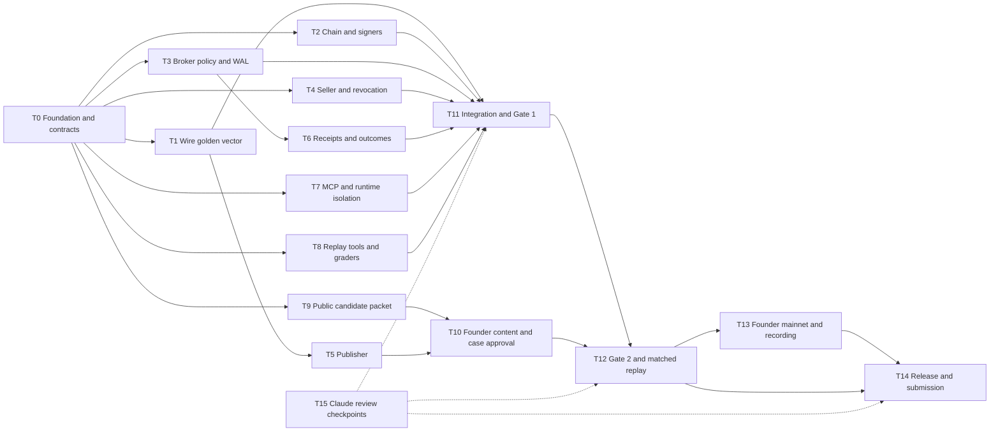

# Parallel implementation task graph

## 要約

最初に共通型・依存関係・検証用 fixture を凍結し、Codex 3作業枠で chain、broker、seller/publisher を並列実装する。Claude は差分と証拠をレビューし、合格の代行はしない。10月10日18時の Gate 1 は実 devnet と人間の署名画面・隔離試験が必要。10月11日10時の Gate 2 は承認済み資料・撤回・領収書・評価準備を確認し、正午に機能を削減する。創業者の実鍵、実資金、全文承認、事例判定、mainnet 承認、録画、公開・提出は代行しない。無料比較 B と安全試験は削らない。

## Execution contract

Dates/times are **JST** (Singapore is one hour earlier). Binding sources: [ledger](../decisions.md), [master M11/M12](../design/10-master-design.md#m11), [stack/contracts](00-stack-and-layout.md), and [provisional decisions](decision-log.md). Planning estimates are **UNVERIFIED**, not observed throughput. This file defines future implementation; no task is complete because its plan exists.

Ledger refresh during drafting: D16 selects the **Colosseum Solana Ecosystem track**; D17 limits founder-funded mainnet setup to approximately USD 5 total in new dedicated wallets (approximately 0.03 SOL + 0.1 USDC plus margin, subject to current-value check), never the main wallet. M03's single 0.01-USDC purchase and fee ceiling still apply. D15 permits specific project notes, but the present request's public-only drafting scope is retained; no notes/private brain access is a task dependency.

Use three active Codex worker lanes plus a lead integrating locally and a Claude reviewer at checkpoints. Reviewer capacity is review time, not a fourth implementation lane. Budget approximately 55–75 worker-hours distributed across lanes and 28–34 active lead implementation/integration hours inside 10–12-hour operating windows; founder budget is approximately 16 focused hours plus 2 reserve. If throughput misses these assumptions, cut case count/polish, never controls. Re-estimate after first contract fixture, first human flow, first two page reviews and first full triple.

All tasks work against local branches; **no remote, push or external messages**. Lead creates sibling git worktrees from the stated merged prerequisite SHA, with one branch/worktree per active task. Lead installs dependencies with `--ignore-scripts` and stages pinned tools; sandbox workers do not install or call devnet. No shared mutable DB or `.local` across worktrees. Commit small validated changes on task branches after secret scan; if environment forbids git writes, leave exact diff/check log for lead to commit, never imply a commit exists. Lead integrates only reviewed, scoped commits; no blanket rebase/reset/cleanup of another worker's changes.

Ownership below is exclusive. A task cannot edit contracts, package files, another task's migrations or tests. Send a contract change request to the lead, who updates T0-owned files, validates affected consumers, then hands back. T0 creates typed interfaces/schema names before others stub against them; T1 completes wire validation without changing frozen signatures unilaterally. Shared root entrypoints and composition are lead-owned integration work in T11. Task-local scripts have named subdirectories to avoid conflicts. `.local` evidence is never automatically public; only reviewed content-free summaries go under `docs/evidence/`.

Labels: **S** = sandbox-only after dependencies/tools are staged; **N** = network/host work run by lead; **F** = founder execution. `M11 T1` refers to master acceptance bundle, whereas `T1` alone below refers to implementation task. Gate1(a–f) are the six master payment items; their full mapping is below. Every acceptance check needs a bad case, clean counterpart, expected/observed result and revision. Synthetic checks are not promoted to live evidence.

## Graph, parallel lanes and merge order



Recommended lanes: A = T1 → T2 continuation/verification → T7; B = T3 → T6 → T8; C = T4 → T5. Lead bootstraps T0, starts T2's narrow SDK probe while T1 is built, collects T9 and runs network/host integration. T8 can start earlier against frozen fake ports when B is waiting; no more than three simultaneous workers are assumed. T7's capability probe starts with lead on Oct 9 even if full implementation comes later. Founder T10 proceeds alongside engineering from the first inert packet. Claude T15 reviews interfaces early and subsequent diffs read-only while workers continue independent tasks.

Merge order: T0 contracts/bootstrap → T1 golden wire → T2 and T3 (either order, no overlap) → T4 → T5 and T6 (either order) → T7 and T8 → T9 public packet index/T10 approvals → T11 integration checkpoint → T12 evidence → T13 evidence → T14 release. Starting against contracts before a dependency merges is allowed; declaring task acceptance without the real dependency is not. Rebase only the task's own clean branch onto the lead's integration tip. After integration changes, rerun affected checks and record the exact final SHA; earlier results remain historical evidence.

**Engineering critical path:** T0 → T1 → {T2,T3,T4} → T6/T7 → T11 actual Gate1 → T12 Gate2/live triples → T13 → T14. **Founder serial path:** public candidate packet → exact-byte/rights/case approval T10 → Gate2 acceptance → signatures/adjudication → mainnet approval/recording → public history review/submission. **Early feasibility blockers:** script-free Solana/MCP install, HumanCliSigner sign-only recovery, actual Codex capability/token enforcement, H1 host isolation, devnet funding and second RPC. Probe all on Oct 9; do not discover them during recording.

## T0 — Foundation, dependency freeze and shared contracts

- **Branch / owner:** `impl/t0-foundation`; lead, with Codex foundation worker if available.
- **Files owned:** root package/lock/tsconfig/.npmrc/.node-version/.gitignore; `src/wire/contracts.ts`, initial `src/wire/schemas.ts` type skeleton and `constants.ts`; `src/common/**`, `test/common/**`; `config/dependencies/**`, `config/tooling-pins.json`; `scripts/check/**`, `scripts/test/**`, `scripts/build/**`, `scripts/assert-toolchain.ts`; `.github/workflows/ci.yml`. T1 takes `schemas.ts` ownership after explicit handoff. Lead retains contracts/constants and common migrations thereafter.
- **Dependencies / mode / estimate:** none; S + N lead dependency/tool probes; 3–4 Codex hours, ~1.5 lead hours plus bounded probes.
- **Acceptance:** stack document's pins installed script-free; SQLite transaction/rollback/WAL smoke, UTF-8 type runtime, typecheck, typed stub consumers; `.local` ignored before keys; no native-required dependency. Future CI content is prepared but not claimed run. M11 T1 foundation and T3/T8 DB durability prerequisites; no Gate1 live credit.
- **Lead verifies:** exact package availability/peer/engine/imports including TS5.9/Node24 types, license/audit evidence, npm version, scanner official checksum and action SHAs; 30-minute x402/Pay.sh official-source spike (record support/unknown, implement no adapter). Capture Codex CLI version/help and start T7 capability probe. D14 consultation already occurred for this plan; routine implementation does not reopen ledger choices.

```text
Implement T0 on impl/t0-foundation; read decisions, MASTER, impl stack and this task.
Touch only T0-owned paths; no application feature work or other docs.
Freeze cross-module contracts and M03 constants exactly as planned.
Use supplied project-local dependencies; do not install or use network in sandbox.
Add .local/ ignore before generating any test material; never commit keys.
Provide Store/Clock adapters, typed stubs, meaningful DB smoke and CI scripts.
Record unavailable dependency/runtime checks as UNVERIFIED for lead.
Run available type/runtime checks and secret scan; commit only scoped verified work.
Hand off signatures, pin evidence, exact test commands, failures and remaining probes.
```

## T1 — Strict wire, signatures and golden artifact chain

- **Branch / owner:** `impl/t1-wire`; Codex worker A.
- **Files owned:** `src/wire/**` except lead-owned contracts/constants; `test/wire/**`, `fixtures/wire/**`.
- **Dependencies / mode / estimate:** T0 contracts; S; 4–5 Codex hours.
- **Acceptance:** one complete public registry → manifest → quote → arm → answer → chain-evidence → receipt vector works across exported parsers; M11 T1 mutation controls cover every domain/signature, unknown fields/versions/key IDs, escaped duplicate keys, invalid UTF-8/surrogates, Japanese byte boundaries, caps and span equality. No committed secret fixture keys; runtime vectors use ephemeral keys or public published vectors. Gate1(c) format-negative foundation only.
- **Lead verifies:** 01 §5 fields with M04 changes, full registry hash, manifest inventory excludes self, answer salt is committed and hidden before reveal, amounts canonical and no float math. T1 emits fixture hashes, not just pass counts; same vector used by T2/T4/T5/T6.

```text
Implement T1 wire validators and public golden artifact chain on impl/t1-wire.
Read binding decisions, M03/M04, 01 section 5 and frozen T0 contracts.
Own wire implementation/tests/fixtures only; ask lead for contract changes.
Reject duplicate decoded keys before materialization, unknown fields and invalid UTF-8.
Use JCS plus domain-separated Node Ed25519; never implement crypto primitives.
Cover bad/control pairs, Japanese spans, registry/manifest/commitment mutations.
No package changes, private sources, network or committed secret seeds.
Return vector hashes and tests proving downstream byte compatibility.
```

## T2 — Legacy chain adapter and both signer implementations

- **Branch / owner:** `impl/t2-chain`; Codex worker A (lead starts network feasibility probe in parallel with T1).
- **Files owned:** `src/chain/**`, `test/chain/**`, `fixtures/chain/**`, `scripts/chain/**`, `scripts/devnet-setup.ts`. No common migrations or broker policy edits.
- **Dependencies / mode / estimate:** T0 contracts for start; T1 golden acceptance before merge; S implementation, N lead funding/devnet; 6–8 Codex hours.
- **Acceptance:** exact three-instruction legacy round-trip and re-verification; no extra accounts/instructions; payer −10000/recipients +9000/+1000; genesis, mint, decimals, ownership, deltas and finality validated independently. Fake RPC pending/failure/expiry disagreement tests. TestSigner rejects mainnet. Human helper validates/TTY-displays frozen message, denies substitution, journals before returning, recovers same signature. M11 T3/T4, Gate1(a,b,c,f) preparation; live evidence reserved for T11.
- **Lead verifies:** script-free SDK works, CLI-format keypair import with a throwaway key and no real file in agent context; three ATA idempotent setup, modest bounded airdrop, distinct second RPC origin, real negative second-leg test design and no production bypass. Human TTY ceremony itself must be exercised by founder for Gate1(f).

```text
Implement T2 only in chain and its named tests/setup scripts.
Use web3.js + spl-token, LEGACY transaction, seller/fee TransferChecked then Memo.
Freeze exact bytes and decode independently before and after signing.
Implement injected RPC, TestSigner and HumanCliSigner protected IPC/helper journal.
No Solana CLI dependency; devnet setup must resume safely and enforce genesis.
Test substitution, finalized-only verification, expiry ambiguity and signature recovery.
Use synthetic/local keys under ignored .local only; no real funds/network in sandbox.
Return lead-run devnet commands, expected raw evidence and all UNVERIFIED checks.
```

## T3 — Protected broker policy, reservations and recovery

- **Branch / owner:** `impl/t3-broker`; Codex worker B.
- **Files owned:** `src/broker/**` excluding `receipts/`, `outcomes/`, `import/`; `test/broker/core/**`, `fixtures/broker/**`. Coordinate migration requests through lead/T0.
- **Dependencies / mode / estimate:** T0; T1/T2 real ports before integrated acceptance; S; 6–8 Codex hours.
- **Acceptance:** M11 T2/T3/T4: bad question/slot/attachment emits zero seller requests, signer calls and broadcast; 2–3 pinned checks with declined/ready/unavailable distinctions, deterministic lowest-price/seller-ID tie selection, one purchase. Atomic cross-session reservation, request replay/body conflict, cap+1, concurrent cap races, UTC midnight/restart, selected quote durable before approval, arm/sign/broadcast journal ordering. No failover after arm. Gate1(c,d,e) preparation.
- **Lead verifies:** all M03 caps are shared constants including durable free-check quotas; fake clock tests avoid sleeps and identity rotation. Pending/null never becomes failed or zero spend; actual charged fee survives failed principal; two-endpoint expiry absence required; signed bytes rebroadcast identically. Broker process alone owns DB/policy; MCP cannot mutate config/admin state.

```text
Implement T3 broker core using frozen ports; edit only its owned paths.
Resolve approved exact questions before seller I/O; preserve M02 bounded fan-out.
Reserve principal and maximum fee atomically with durable idempotency/CAS.
Persist selected quote, arm, signed bytes and state in the required order.
Recover one existing consult/message; never replace a pending purchase.
Test concurrency, crash boundaries, UTC rollover, forbidden questions/payees and caps.
Request shared migration/contracts from lead; no silent signature changes.
Report negative-control signer/network counts and recovery evidence.
```

## T4 — Extractive seller, controller/worker split and revocation

- **Branch / owner:** `impl/t4-seller`; Codex worker C.
- **Files owned:** `src/seller/**`, `test/seller/**`, `fixtures/seller/**`, `scripts/seller/**`.
- **Dependencies / mode / estimate:** T0 start; T1/T2 validation ports at merge; S; 5–7 Codex hours.
- **Acceptance:** signed prepared answer and quote committed together before payable response; finite map/decline, minimum response delay, queues/admission bounds, no LLM/network in worker. Controller authenticates per-origin invitations and buyer ownership on every private route; generic ready metadata contains no answer/spans/salt. Durable tombstones stop quote/arm/pages/reveal/restore and preserve liabilities; old snapshot safe recovery only if not revoked. M11 T1/T2/T6/T7, Gate1(c,e) foundations.
- **Lead verifies:** controller independently observes finality/deltas rather than trusts proof; typed seal signer separated from worker; real keys/approved manifest signing remains human controlled. Revocation linearizes with delivery authorization and restart starts offline until newest independent tombstone state is loaded; acknowledgment stale/missing means not ready. Two listing namespaces are labeled same operator, not tenants.

```text
Implement T4 seller controller/worker and deterministic approved-span preparation.
Read M03/M04/M06/M08; own only seller paths and its tests/scripts.
Store answer/signature plus quote before returning ready; never generate after payment.
Authenticate buyer per origin; expose only enumerated seller routes.
Use independent chain verification and serialized revocation/delivery authorization.
Test revoked ready/armed/paid/cache/restore states plus clean lost-response recovery.
No real content, seller secret or network in sandbox; use test injections.
Return route contract evidence, restart tests and unresolved host requirements.
```

## T5 — Safe publisher, scanner gates and listing proposal

- **Branch / owner:** `impl/t5-publish`; Codex worker C after T4.
- **Files owned:** `src/publish/**`, `test/publish/**`, `fixtures/publish/**`, `scripts/publish/**`, `scripts/scan/**`, `config/scanner/**`. Lead alone fills verified scanner binary/checksum pins.
- **Dependencies / mode / estimate:** T1, T4 bundle handoff; S after scanner staged; 4–6 Codex hours.
- **Acceptance:** M11 T5/T7: scanner built-in detection + independent custom marker + clean control; missing scanner/error/skipped bytes fails closed. Exact inventory equality, no links/traversal/hardlinks/symlinks/hidden files/active HTML, changed approved byte requires new approval. Two synthetic private-corpus variants yield identical public output with fixed metadata; outside canary absent. `list` produces inactive proposal only, no auto publish. Gate2 content pipeline; no approval credit from scans.
- **Lead verifies:** English/Japanese business/PII guard limitations explicit, rules cannot be disabled by candidate files, nine-field review packet and whole-page download permission, source/rights freshness/revocation acknowledgment, signature approved payload hash, interrupted copy never half-activates. Run with sanitized synthetic originals; founder runs any private-original scan outside AI.

```text
Implement T5 publisher validation/seal/list and scanner harness in owned paths.
Read M07 and stack content policy; do not access a private brain or repo.
Build from exact approved allowlist into empty staging with byte-level inventory.
Require scanner success and protected approval hashes; never equate them.
Reject links, hidden/unlisted files, provenance leaks and changed approval bytes.
Use synthetic corpus-pair/canary and bad-clean scanner controls.
Emit inert review packet and listing proposal; activation is founder-only.
Return command sequence, approval hash semantics and fail-closed evidence.
```

## T6 — Durable receipts, gbrain fallback and outcome ledger

- **Branch / owner:** `impl/t6-receipts`; Codex worker B after T3.
- **Files owned:** `src/broker/receipts/**`, `src/broker/outcomes/**`, `src/broker/import/**`, `test/broker/receipts/**`, `test/broker/outcomes/**`, `test/broker/import/**`, `scripts/receipts/**`.
- **Dependencies / mode / estimate:** T1/T3; S, N lead installed-gbrain probe; 4–5 Codex hours.
- **Acceptance:** M11 T8/T9: receipt/artifacts/outbox durable before delivered response; import failure no repurchase, idempotent import, restarted readback, declined null/not-applicable flags. Signed hostile prose remains untrusted and revoked import suppresses retrieval. Local full receipt + metadata-only fallback tested, pending on unavailable importer. Forged human/independence/source, duplicate/other-buyer feedback rejected; refund retains failure; all paid consults in reliability denominators. Gate1(e) durable receipt requirement; Gate2 T8.
- **Lead verifies:** installed gbrain help/version only, dedicated isolated synthetic source and exact import/readback capabilities; no private/default-source search. Path prefix is not isolation. If quoted retrieval fails, founder accepts explicit `metadata_only` reduced-conformance label; no unsupported full-storage claim. Public report has three evidence classes, actual amounts/network fees, zero independent count and no score.

```text
Implement T6 receipts/outcomes/import only in owned broker subdirectories.
Read M06/M09; use Store transactions and isolated importer interface.
Persist full local receipt before success; import is retryable outbox work.
Test planted instructions, import outage/restart/idempotency and post-import revocation.
Implement metadata-only and pending fallback honestly; never search private gbrain.
Derive source/eligibility server-side, preserve failures/refunds/unknowns and denominators.
Return fake-import tests plus bounded lead probe instructions for actual readback.
```

## T7 — MCP bridge and verified runtime boundaries

- **Branch / owner:** `impl/t7-isolation`; Codex worker A; lead owns host probe execution.
- **Files owned:** `src/mcp/**`, `test/mcp/**`, `fixtures/security/**`, `test/acceptance/isolation/**`, `scripts/runtime/**`, `deploy/**`, `config/runtime/**`.
- **Dependencies / mode / estimate:** T0 ports; T2/T3/T4/T8 for full host controls; S implementation, N host/model auth probes; 5–7 Codex hours, lead first 30-minute probe on Oct 9.
- **Acceptance:** M11 T6/T3/T10 and Gate1(f): actual allowed tool inventory, no shell/file/browser/plugin/connector escape, no broker DB/home/key/admin/socket/rubric/cross-arm access, no worker egress, no arbitrary tool path/command. All three injection directions run through enforced runtime, not just scan rejection. Clean permitted check/repair and authenticated market call work. 1 GiB/resource and restart evidence captured. Read-only Codex sandbox alone is a failing proof.
- **Lead verifies:** actual Docker/VM or dedicated host boundary with sanitized mounts/network rules; no installation assumed. Codex 0.160.0 subscription model availability, explicit config disables and MCP required startup, clean config/auth handling; tool inventory/canaries and native token-budget capability with tiny cap. Missing narrow tool mode/hard budget means live replay blocked. Credentials never handed to worker. No cloud rescue without separate authorization.

```text
Implement T7 restricted MCP bridge and role isolation configs in owned paths.
Expose only five market methods and the named task tools for each arm.
Runtime buyer must not import broker implementation or mount host state.
Disable inherited Codex tools/config/plugins; prove actual capability inventory.
Add negative canaries for DB/key/home/admin/network and all three injection directions.
Keep a clean allowed repair as positive control; report untested host assumptions.
No broad sandbox bypass, new API spend or credentials in logs.
Hand lead exact host/model probes; mark paid/live replay blocked if isolation fails.
```

## T8 — Matched replay, named tools and deterministic grader

- **Branch / owner:** `impl/t8-eval`; Codex worker B.
- **Files owned:** `src/eval/**`, `test/eval/**`, `fixtures/eval/synthetic/**`, `scripts/eval/**`, `config/eval/**`. Hidden live rubrics/runs remain lead-protected `.local/eval/`, never buyer fixtures.
- **Dependencies / mode / estimate:** T0 start with fake ports; T6/T7 for real replay; S; 4–6 Codex hours.
- **Acceptance:** M11 T10, with T2/T6/T8 shared boundaries: fixture operations are finite IDs with server validation; A/A grades identical, tampered frozen fixture aborts, rubric/cross-arm canaries inaccessible. Same A/B/C snapshots/prompt/tools except treatment, rotating order, fresh contexts, frozen model/config, 10min/8000/30 budgets and one C purchase. B has exact corpus/map. Preserve all attempts/unknown/budget failures; report A–C/B–C contingency counts, unrun/incomplete triples, human/model/chain time separately. Synthetic success contributes no historical n/Gate1 credit.
- **Lead verifies:** grader PASS requires actual allowed evidence-producing action, not a recommendation or no-op; first full triple elapsed time + founder active minutes; no label leaks or outcome-selective retries. TestSigner rehearsal is labeled; primary C uses human-signed devnet after Gate1. Stop on token enforcement/model-auth uncertainty rather than replacing Codex with an API model.

```text
Implement T8 named toy tools, frozen A/B/C runner and external deterministic grader.
Own eval paths only; use synthetic public fixtures and frozen ports.
Match free B exactly to C's source/map, keep task checks available in all arms.
Enforce call/time/purchase budgets; surface unresolved token-cap enforcement.
Hide rubric/solution/cross-arm data outside runtime; test A/A and tamper controls.
Preserve all attempts, unknowns, incomplete triples, failures and expenses.
No historical claims or live calls from sandbox; hand off reproducible synthetic results.
```

## T9 — Public-source candidate content and incident packet

- **Branch / owner:** `impl/t9-content-packet`; lead, Codex content worker during a free lane.
- **Files owned:** `fixtures/content/demo/**`, `docs/evidence/content/candidate-index.md`; drafts/attribution/review packets under ignored `.local/content-candidates/`, historical fixture candidates under `.local/incident-candidates/`. Do not commit real candidate lesson text before founder rights/release review.
- **Dependencies / mode / estimate:** T0 constants, T5 packet format for final output; N lead public GitHub fetch; S drafting; 3–4 Codex hours with 30-minute initial public inventory cap.
- **Acceptance:** D14 public-only draft provenance, five distinct useful lesson candidates + five separately labeled demo pages, ten finite development questions/ten negatives, answer-span candidates and all hashes. Chronological 90-day case inventory with family/exclusion/unknown counts and no results-based selection. M11 T5/T10 preparation; no content approval or historical-count credit yet.
- **Lead verifies:** only founder-authored public portions and clearly personal repos, no others' comments/business-derived text; rights unknown remains excluded/pending. Candidate before-states reconstructible; public facts cited by immutable revision/date. No private source/connector or memory-derived incidents. Founder gets an inert exact-byte packet, not a request to compose five pages from scratch.

```text
Prepare T9 candidate packet from lead-provided PUBLIC source bytes only.
Read D12-D14 and M07/M10; do not query private brain/repo/connectors.
Draft five lessons: evidence, leftovers, bounded retries, recovery, existence vs readiness.
Supply Trigger/Failure/Fix/Evidence/Limits and precise source/rights uncertainties.
Prepare finite ten-question map, ten negatives and separate five-page synthetic demo.
List historical candidates chronologically with before-state/family/exclusion evidence.
Keep real candidates inactive in .local until exact-byte founder approval.
No invented incidents, contribution counts, approval, publication or demand claims.
```

## T10 — Founder exact-byte content, question and case approval

- **Branch / owner:** `impl/t10-content-approval`; founder (lead commits approved public projections).
- **Files owned:** `fixtures/content/approved/**`, `fixtures/eval/approved/**`, `config/public-registry.json`, `config/question-policy.json`, `docs/evidence/content/approval-index.md`; private rights/lineage/rubric records stay outside AI mounts. T0 types and T5 tool code remain unchanged.
- **Dependencies / mode / estimate:** T5/T9, early review from first packet; F; 0.5–1 Codex packaging hour, ~4–5 founder hours spread across Oct9/10 content/cases (within daily budget).
- **Acceptance:** actual useful five-page founder slice, reviewed five-page demo, exact metadata/page/question/map/license/download hashes approved; signed manifest, full-registry repin, freshness ack and takedown drill. Founder confirms real before-states/rights and overlap exclusions, approves frozen rubric/primary IDs before results. M11 T5/T7/T10 actual approval layer; Gate2 core.
- **Lead verifies:** approval binds bytes/version, no scan override of prohibited origin, no synthetic historical n, declined/ready listing pair retained. If five useful real pages fail, real seller stays inactive; synthetic demo and unmet milestone remain possible. At least one real matched triple must be executable for historical readiness; target ten shortfall is not privacy failure.

```text
Prepare the T10 inert review/seal session for founder; do not approve on their behalf.
Show exact byte diffs, scans, public rights/download terms, finite questions and hashes.
Founder reads and approves; any changed bytes return to review before seal.
Record public approval IDs and case counts only; never copy private lineage/rubric.
Validate and propose activation; founder signs real manifest and repins registry.
Report actual approved page/case counts, exclusions, freshness and unresolved items.
```

## T11 — Compose services, actual devnet suite and Gate 1

- **Branch / owner:** `impl/t11-gate1`; lead; founder participates in human TTY acceptance.
- **Files owned:** `scripts/broker.ts`, `scripts/seller.ts`, `scripts/mcp.ts`, `scripts/operator.ts`, `scripts/integration/**`, `test/integration/**`, `test/acceptance/payment/**`, `docs/evidence/gate1/**`. Fixes in other task-owned code are handed back to their owners, not silently piled into integration.
- **Dependencies / mode / estimate:** T1/T2/T3/T4/T6/T7 plus T8 allowed-tool controls; synthetic bundle adequate for engineering suite; S composition, N real devnet/host, F human helper; 4–6 Codex hours + 3–4 lead hours; **deadline Oct10 18:00**.
- **Acceptance:** all M05 Gate1(a–f), M11 T1–T4/T6 plus T8 durability. Complete real devnet split and finalized failed-second-leg fee/rollback, malicious/replayed proofs, forbidden-question zero I/O, concurrent cap/restart-midnight behavior, genuine lost-response/restart returning identical eligible answer and receipt, protected DB failure before sign, human exact-message approval and runtime canaries. Retain raw read-only RPC evidence/signatures/balances/explorer links on exact SHA. A locally green test alone is not pass.
- **Lead verifies:** primary/secondary RPC origins and genesis; failure actually landed on devnet, no preflight-only substitute; human adapter exercised by founder on throwaway key; fees/principal/test classifications separated. Missing any required item means failed/unverified Gate1, paid mode/mainnet disabled. Same-SPL fix before cut can reopen only after full rerun, logged late recovery and founder schedule acceptance.

```text
Integrate only reviewed T1-T8 ports under T11 entrypoints/tests.
Run deterministic bad/control suite first; leave actual devnet execution to lead.
Prepare Gate1(a-f) scripts with exact expected evidence and restart fault points.
Do not equate simulator, preflight rejection or TestSigner with missing live/human proof.
Preserve signed WAL, pending reservations and obligations during restart/restore.
Write per-item verdict on exact SHA; failed or unobserved means paid mode off.
Return isolated defects to owning workers and rerun affected then final gate suite.
```

## T12 — Gate 2, safe import and actual matched replay

- **Branch / owner:** `impl/t12-gate2-replay`; lead; founder signs/adjudicates real cases.
- **Files owned:** `test/acceptance/content-receipts/**`, `scripts/gates/**`, `docs/evidence/gate2/**`, `docs/evidence/replay/**`; raw runs/rubrics private `.local`. No edits to frozen primary fixtures without invalidating/restarting protocol before results.
- **Dependencies / mode / estimate:** T5/T6/T7/T8/T10/T11; N runtime/model/devnet/gbrain, F verdicts; 2–3 Codex report hours + ~3 lead active hours and actual serial runs; **Gate2 Oct11 10:00**, runs afterward.
- **Acceptance:** Gate2 per dimension: useful approved pages/demo, scans/lineage/host/citations/revocation including backup and imported states, frozen admissible case set and A/B/C protocol, actual receipt readback or labeled tested fallback. M11 T5/T7/T8/T9/T10; T10 runtime evidence produced before claims. One full triple timed Oct10 evening after Gate1; all primary attempts count. Complete 3–5 cases only if remaining human/clock budget permits; report target shortfall/unrun cases in original order.
- **Lead verifies:** installed gbrain features, real safe-readback/no-action positive/negative controls; founder fallback acceptance. Model/config unchanged, budget compliance and actual human signatures, no coaching, hidden rubric, actual evidence trace preceding paired improvement. Gate2 is readiness, not a claim all replays completed. C simulated after failed Gate1 cannot enter live-paid counts. Unknown/negative/free-B parity stay prominent.

```text
Run T12 gate/report integration; do not alter frozen cases to improve outcomes.
Collect per-dimension Gate2 evidence, including actual gbrain mode and revocation restore.
Time one whole A/B/C triple with identical tools/budgets and founder procedural signing.
Preserve attempts and grade from actions, never final-answer confidence.
Reconcile A-C/B-C counts, incomplete/unrun totals and actual wall/human/token/spend data.
If blocked, show exact missing dimension; never label readiness as completed evaluation.
```

## T13 — One founder mainnet purchase and final recording

- **Branch / owner:** `impl/t13-recording`; founder, lead prepares public read-only evidence views.
- **Files owned:** `docs/evidence/mainnet/**`, `docs/evidence/demo/**`; raw recording/receipt `.local/recording/`, no wallet secrets. No feature implementation.
- **Dependencies / mode / estimate:** T11 full Gate1, T12 safe slice/host/receipt fallback and all applicable M11 controls, T15 review; F + N; 0.5–1 Codex evidence-pack hour, founder mainnet/recording time from Oct11 4-hour allocation.
- **Acceptance:** founder provisions NEW dedicated wallets only under D17's approximately USD 5 total funding ceiling, never the main wallet; setup/rent and funding are included in the reviewed budget. Fresh explicit runtime approval of verified Circle USDC mint/live program/decimals/genesis, distinct payer/seller/market addresses and ATAs, 10000/9000/1000 units, ≤100000 lamport purchase fee, exact immutable message digest. One finalized success locks mainnet; no retake purchase. Whole receipt and actual delivery/outcome recorded, self-transfer label. Reuse recording for edits, preserve null findings/free B. M11 T1–T9 release smoke; no negative mainnet tests.
- **Lead verifies:** founder alone provisions real keys/funds/setup and approves; sign-only helper/recording cannot expose file/key/notifications. Separate setup/rent fees disclosed. Mainnet failure/ambiguity stays pending/no auto retry; absence of runtime approval means no mainnet and explicit milestone miss. Internal demo ≤3min, pitch 2–3min subject to actual form verified by founder. First complete recording by Oct11 18:00.

```text
Prepare T13 evidence-only terminal views and recording checklist.
Do not load a real key, move funds, sign, publish or record for the founder.
Verify public mainnet facts and present exact quote/message/fees for fresh approval.
Use the one-success latch; reuse existing recording instead of purchasing again.
Keep devnet/synthetic/replay/mainnet and missing milestones visibly separate.
Hand founder minimal capture sequence and redact only secrets, never adverse results.
```

## T14 — Reproducible release packet and founder submission

- **Branch / owner:** `impl/t14-release`; founder for publication/submission, lead for local preparation.
- **Files owned:** `README.md`, `LICENSE`, `CONTENT-LICENSE.md`, `NOTICE.md`, `docs/release/**`, `docs/evidence/release/**`; no features/new integration.
- **Dependencies / mode / estimate:** T12, T13 result or explicit mainnet miss, T15 release review; S local package, N/F public actions; 2–3 Codex hours + ~2 lead active hours; internal deadline **Oct12 18:00**.
- **Acceptance:** fresh checkout script-free install/check/tests/scans/build, pinned devnet reproduction and limitations, rights/notices/history scan, exact-release smoke with all applicable acceptance mappings. Founder authorizes actual public remote creation/release after D12 history/rights review, checks logged-out links/video durations, submits and saves actual confirmation/time. No claim of live CI if no remote/run exists. Smaller safe demo lists unpaid/import/eval misses explicitly.
- **Lead verifies:** no keys, private hashes/questions, auth or `.local` in git history; code MIT/content CC BY only for approved eligible material, third-party notices intact; docs claims match evidence. Founder selects D16's Solana Ecosystem track and reconfirms registration/form/AI/pre-existing-code rules and official deadline from repository facts. Official end Oct13 15:59 JST is recovery margin, not feature time.

```text
Prepare T14 local reproducibility and submission packet; touch release-owned paths only.
Use actual release SHA and per-layer evidence, including failed/unrun requirements.
Run exact-release smoke, secret/history and rights/license checks.
Write MIT code and approved CC BY content notices; preserve third-party terms.
No remote/push/publication without founder's final release action.
Provide founder logged-out link, video/form and confirmation checklist.
```

## T15 — Claude review checkpoints, without shared-file edits

- **Branch / owner:** `impl/t15-review-evidence`; lead coordinates **Claude reviewer**, separate from Codex implementers.
- **Files owned:** `docs/evidence/reviews/**` only, written by lead from reviewer findings. Claude has read-only diffs/tests/evidence; no application edits, keys or private sources.
- **Dependencies / mode / estimate:** T0/T1 interface checkpoint, T2–T7 payment/boundary checkpoint before Gate1, T10/T12 claims checkpoint, T14 final release diff; S local review artifacts, N subscription invocation if needed; 0.5–1 Codex handoff hour, ~2–3 Claude review hours across checkpoints.
- **Acceptance:** each finding identifies concrete invariant/path/trigger/consequence and suggested bad/control test; lead records fixed/rejected-with-evidence/open. Review covers M11 T1–T10 and all Gate1 items, especially mismatched sign bytes, pending-spend races, restored revoked content, unsafe import and misleading eval. No invented execution/model attribution; record actual CLI/model if observable.
- **Lead verifies:** critical unsafe-payment/private-data defects block paid release until fixed and rerun; reviewer cannot waive a gate or count its opinion as runtime proof. If reviewer unavailable, flag review incomplete and perform lead review; never claim Claude reviewed. Routine implementation owners keep their code ownership.

```text
Read-only Claude review of the attached SHA/diff and sanitized acceptance evidence.
Authority: decisions D5-D14, MASTER M03-M12, frozen impl contracts.
Do not edit files, call live APIs, read private content or request keys.
Find concrete payment, isolation, durability, revocation, wire or evidence defects.
For each finding give location, trigger, consequence and bad/control verification.
Separate demonstrated defect, design concern and missing runtime evidence.
Never waive founder actions or count green unit tests as live acceptance.
Return prioritized findings and exact reviewed revision/model metadata if available.
```

## Gate evidence matrix and integration checkpoints

| Master acceptance | Implementers | Lead evidence/checkpoint |
|---|---|---|
| M11 T1 wire/exact bytes | T0/T1/T2/T4/T5 | Golden fixture at first merge; every consumer accepts same hashes, mutation rejects. |
| M11 T2 question/fan-out | T3/T4/T7 | T11 local reject before network; real permitted ready/decline, ≤3 checks/one selection. |
| M11 T3 money boundary | T2/T3/T7 | T11 concurrency/restart/midnight/cap/substitution and human key/admin denial. |
| M11 T4 chain/recovery | T2/T3/T4/T11 | Actual devnet success/failure/raw finality and identical recovery; pending never unlocked. |
| M11 T5 publication/P3 | T5/T9/T10 | T12 scanner pair/corpus invariance/exact approval/clean listing. |
| M11 T6 host/three injection directions | T4/T7/T8 | T11 actual runtime bad/clean controls; same released deployment configuration. |
| M11 T7 revocation | T4/T5/T6 | T12 ready/armed/paid/cache/backup/imported revocation and preserved liabilities. |
| M11 T8 receipts | T3/T6 | T11 pre-sign DB failure/post-pay local receipt; T12 actual isolated readback/fallback. |
| M11 T9 outcomes | T6/T12 | Forgery/duplication/exclusion tests and reconciled denominators/refund record in report. |
| M11 T10 eval | T7/T8/T10/T12 | Actual matched triples, inaccessible rubric, A/A control, frozen hashes/budgets/all attempts. |
| Gate1(a) finalized atomic success | T2/T11 | +9000/+1000 TEST, payer −10000, exact Memo, fee and finalized raw transaction. |
| Gate1(b) failed second leg | T2/T11 | Landed devnet failure at second transfer; all principal deltas zero, actual SOL fee. |
| Gate1(c) proof/policy/restart/races | T1/T2/T3/T4/T11 | Wrong buyer/network/payee/memo/mint/amount and replay reject; restart/cap controls. |
| Gate1(d) free/blocked invariant | T3/T7/T11 | Unsupported question and unauthorized purchase: zero sign/broadcast; admission reject also zero seller I/O. |
| Gate1(e) lost response | T3/T4/T6/T11 | Kill/drop after finalized chain/before response, restart same ID; identical answer/receipt, no second transfer. |
| Gate1(f) human/runtime boundaries | T2/T7/T11 + founder | Actual HumanCliSigner devnet TTY approve exact digest, substitution denied, key/admin canaries denied and clean task passes. |

Evidence record format for every checkpoint: implementation SHA, lock/tool/config/image hashes, environment and timestamp/network, fixture/request IDs and hashes, expected/observed result, counts of seller calls/signatures/broadcasts/transfers, raw read-only RPC artifact references where applicable, restart point, positive control, verdict `pass | fail | unrun | blocked`, owner. No credentials/raw private content. Append observed corrections rather than erase failure attempts. Release gate checks use exact final config/SHA or explicit unchanged-component provenance plus final smoke; do not silently apply old pass results to modified controls.

## Founder-only minimal actions and blocking points

| Action | Minimal founder work | When it blocks |
|---|---|---|
| Real keys and funds | Privately create NEW dedicated CLI-keypair wallets for payer and distinct recipients; set helper permissions. Founder funds later within D17's approximately USD 5 total ceiling and reviews setup/ATA rent/fees; system never uses the main wallet. Never show key bytes to agents/recording. | Mainnet only; TestSigner and throwaway mint allow development to proceed. Human helper Gate1 test can use throwaway devnet key. |
| Real page/question approval | Read exact five pages + demo + metadata/finite questions/map, check origins/rights/whole-page public download/CC BY, approve hashes; sign real manifest and pin entire registry. | Real listing activation and Gate2; no silence-as-approval. Recheck ≤24h/before each session; set tombstone if withdrawn. |
| Historical incident adjudication | Review candidate before-state/rights/family-overlap/rubric, freeze primary IDs; later grade masked outputs where practical and resolve disputes. | Historical readiness/results. Synthetic runs continue but cannot count as historical n. |
| Human devnet acceptance/replay | Approve offer then exact armed digest in protected terminal for Gate1 helper proof and each primary C arm; no after-start coaching. | Gate1(f), primary paid replay. TestSigner rehearsals cannot replace this evidence. |
| Host/takedown and receipt fallback | Observe prepared isolation/takedown/readback packet and accept actual `quoted`, `metadata_only` or unmet `import_pending` label. | Paid final-content mode, Gate2/mainnet claims. |
| Mainnet runtime approval | Review fresh network/mint/accounts/split/fees/manifest/policy/digest and sign once after gates. | Mainnet requirement; no automatic recovery/replacement purchase. |
| Recording | Clear private windows/notifications, record own approval and truthful demo/pitch with actual results/free B; review rendered video. | Final recorded demo. Retakes reuse one payment clip. |
| Public release and submission | Review complete history/rights, execute public release under D12, confirm form/rules/links, submit and retain confirmation. | OSS criterion and actual submission; D7 prohibits earlier remote creation. |

No new founder product-choice meeting is required for SDK/tooling/cloud/content-draft defaults: D14 decisions are already logged. Founder remains free to overrule provisional choices; actual private-data, content, funds and public actions above cannot be delegated by that procedure.

## Daily schedule

| Date / operating window JST | Parallel engineering and lead work | Founder allocation / gates |
|---|---|---|
| **Oct9, 08:00–20:00 (12h)** | 08–10 T0 contracts/pins/scanner; start T1/T3/T4 lanes, lead T2 SDK/devnet funding probe and T7 Codex/host probe. By noon sign-only adapter feasibility and actual model/tool inventory blockers known. Afternoon T2 continuation/T5 preparation/T6; T9 public packet; T15 interface review. Initial installed-gbrain probe and one 30min x402 spike. Evening golden vector and synthetic ready/decline integration. | **5h**: capacity confirmed by 10:00; ~0.75h human helper/setup feasibility (D13 removes test-key labor), 2.25h first pages/demo/question review, 1h candidate cases, 1h rights/form/remaining reviews. Five-page draft/candidate counts by evening. No new licence/remote debate. |
| **Oct10, 08:00–20:00 (12h)** | Finish T2/T3/T4 faults, T5/T6/T7/T8 integration; real devnet first run early, not at 17:50. Host constraints proven by noon. T15 security/recovery review and fixes. T11 **Gate1 18:00**; actual itemized verdict. If pass, first complete triple timed by 20:00. Freeze eval protocol/packet by 18:00. | **3.5h**: 1.25h exact-byte sealing, ~0.75h human helper/devnet tests, 1h rubric/checklist/case final approval, 0.5h host/takedown. Founder content and case freeze by 18:00. No autonomous signing stretch. |
| **Oct11, 08:00–20:00 (12h)** | T12 **Gate2 10:00**, readback/tombstone restore proof and actual case count. **Cut 12:00**, no new features. Run retained complete triples with honest report; T13 mainnet only after all gates; first complete recording by 18:00. 18–20 package existing evidence/fix critical defects only. | **4h**: 0.75h Gate2; 1h replay signatures/adjudication; 0.5h mainnet setup/approval; 1.25h recording; 0.5h claims/cut. If first triple shows excess burden, reduce additional unstarted cases, keep B. |
| **Oct12, 08:00–18:00 (10h)** | 4–5 active lead hours critical fixes/exact-release smoke/T14 reproducibility; remaining operating window for scans, artifact rendering, review and submission support, not feature addition. Claude final claims/history diff review. Local release packet ready by noon, link checks after founder release. **Internal submit 18:00**. | **3h**: 1h final video/pitch, 0.75h release/history/rights, 0.75h registration/submission, 0.5h contingency. Additional **0.5h floating reserve within the 16h** can cover an earlier overrun; do not consume the separate 2h official-deadline reserve for features. |

Daily founder allocations total 15.5h plus 0.5h floating = 16h, excluding up to 2h emergency reserve before **Oct13 15:59 JST official close**. Lead/worker throughput does not compress founder reading, signing or adjudication. At Gate2 freeze actual ready cases; ten is a target, not a reason to schedule 300 serial arm-minutes that no longer fit. Record n, unrun cases and reduced conformance.

## Risk triggers and cuts

| Early warning / deadline | Action and first cut |
|---|---|
| T0 script-free imports/typecheck fail by Oct9 10:00 | Lead bounded pin correction with rerun; no native install-script workaround. Cut tooling niceties, retain validation. |
| No effective MCP-only capability set, protected mounts or token cap by Oct9 noon probe | Prioritize T7 hard blocker; no unrestricted runtime buyer. Cut live-replay claims if unresolved; synthetic tests stay labeled. |
| Devnet faucet unfunded/secondary RPC missing Oct9 afternoon | Stop retry loop; reuse same funded test identity/official faucet. Keep simulator work parallel. Missing dual observation retains reservations; no mainnet/provider purchase rescue. |
| Human helper cannot show/sign/journal identical message by Oct9 noon | Fix sign-only port first; paid path blocked. Never substitute autobroadcast or implicit approval. |
| First two page reviews consume >half allocated content time; rights unknown; fewer than five useful pages by Oct10 noon | Narrow length/topic, use new owned neutral experiments with honest labels; do not pad/rewrite forbidden origins. No real slice sale if five useful approved pages unavailable. |
| Crash/revocation race, unaccounted liability, key/canary access or unsafe cached import | Suspend paid tests immediately, preserve ledger/evidence, owner fixes and reruns. No performance/polish work until controlled. |
| Gate1 item absent/failing Oct10 18:00 | Mark failed/unverified, paid demo/mainnet off. Same rail late recovery only before cut after full gate pass + founder schedule acceptance. |
| Gate2 misses approved content/host/readback readiness Oct11 10:00 | Per-dimension failure; metadata-only if tested and accepted, synthetic-only if no real content/cases. No aggregate all-green. |
| First triple exceeds expected time or subscription rate limit / model drift | Fewer predeclared unstarted cases, no optional repeats; record attempts, same frozen model for retained triples. Never drop B or substitute TestSigner paid primary evidence. |
| B matches/exceeds C or no observed improvement | Show null/regression, claim enforcement/accounting only. No product-value “success” rewrite or cherry-picked video. |
| Founder time falls below recording/release minimum at cut | Smaller unpaid/synthetic demo with misses; preserve consent/privacy/safety and actual submission criteria. |
| Final history rights scan or logged-out links fail | Stop public release until fixed; reserve official-deadline margin for submission recovery, not new features. |

At **Oct11 12:00**, follow M12 exact cut order: (1) residual adapters/catalog/autonomous-signing work, (2) generation/embeddings/native staging/page expansion, (3) independent seller onboarding while retaining the reviewed demo listing, (4) graphical/publisher UI/watchers/polish, (5) optional repeats and additional unstarted cases, (6) video embellishment, (7) paid mode if mandatory work still cannot fit. Items already excluded save no additional time. Never cut provenance, key/runtime isolation, exact approvals, budget reservations, atomicity evidence, free decline, citation/signature checks, revocation/restart, free B or truthful reporting.
